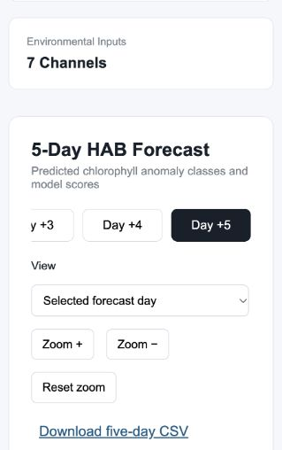

# Dashboard interaction fix — 15 October 2026

The reported slow buttons were primarily an unavailable-forecast interaction problem. The browser showed current-data mode with stale input dates; the API rejected forecast generation, but day/zoom buttons still looked usable without a loaded map. The browser also reused old JavaScript on an ordinary reload; changing the asset URLs caused the new behavior to load visibly.

Changes:

- Day and zoom controls are disabled until a forecast is loaded and are disabled again on an unavailable/error state.
- **Load historical example** explicitly enables demonstration mode, finds a coverage-supported input window, and generates the maps with one click. Its input and target dates stay within 2024.
- Finding, generating and reloading show immediate busy labels; generation also shows progress text and an animation respecting reduced-motion preferences.
- Generation has a 60-second request timeout; saved forecasts use 15 seconds, date lookup 20 seconds. A timeout explains how to retry. Stale-data messages point to the historical action instead of an internal parameter name.
- CSS/JS asset URLs carry an interaction-version query to avoid stale browser code.

Two successful real historical forecast POSTs took **0.735 s** and **0.776 s** on the running local server. Health/system/saved-forecast requests took about 1–3 ms; the covered-date lookup took 0.334 s. These are individual warm-server measurements, not guaranteed cold-start or load-test results. The model, forecast semantics and freshness restrictions were preserved.

Verification: 11 forecast API tests; JavaScript syntax, request-order regression, actual-JSON five-day rendering, view/zoom/export routing; new one-click/busy/timeout regression using both a labeled UI contract fixture and real backend JSON. The new interaction test is included in Makefile and CI. Browser verification confirmed the initial disabled controls, historical example generation and working Day +5 map.

Run the focused interaction test with `node tests/dashboard_interaction.mjs`, or supply a real saved API JSON file as its argument. No model retraining or 2025 evaluation was performed.
