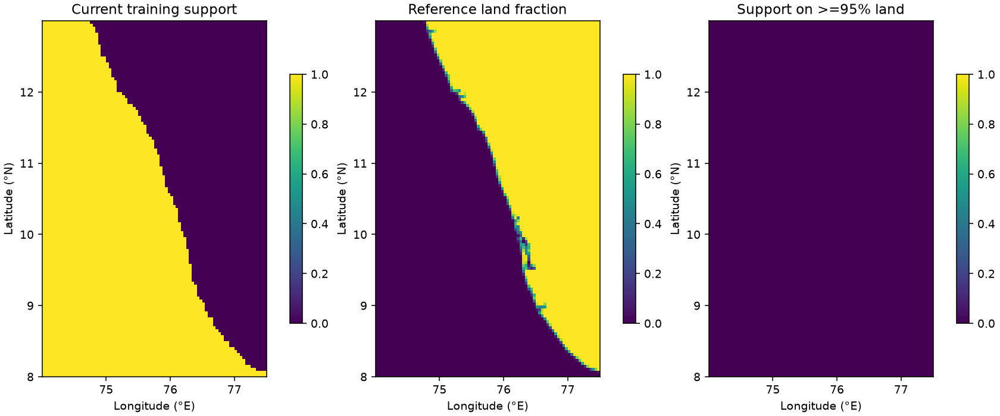

# Roadmap implementation — 15 October 2026

The available engineering and research-validation work is implemented. Real native Sentinel QC and a bounded paired experiment ran successfully. The active model, labels, normalization, decision rules and saved 2025 evaluation remain unchanged. This is still a chlorophyll-anomaly research prototype; no new operational forecasting skill is claimed.

## Implemented stages and measured results

| Stage | Delivered | Outcome |
|---|---|---|
| Baseline | `operations.baseline_audit` reconciles confusion counts, class metrics, false-warning denominators, split-safe windows and frozen hashes | Active model and historical evidence verified; no test-set inference |
| Satellite QC | `operations.sentinel_pilot` validates native file SHA-256/manifest MD5, product identity, decoded units, WQSF masks, scan times and publication ordering; exports sample support/provenance | Two actual 11 February 2024 granules processed; eight required pilot products remain unavailable |
| Geography | `operations.geography` rasterizes physical land GeoJSON onto model support with explicit mixed cells | No supported cells are >=95% land in this reference; no mask replacement justified |
| Evaluation | `experiments.roadmap_evaluation` adds train-fitted seasonal comparison, abstaining persistence, common-cohort comparisons, horizon reliability, proxy episodes and temporal block intervals | Persistence remains stronger on the common 2024 cohort; independent validation is still absent |
| Controlled fusion | `experiments.pilot_comparison` uses frozen scores/model, native publication timing, runtime source-age gates and identical observed targets | Mixed class tradeoffs on four overlapping origins; not promoted |
| Integration | Existing staged fusion accepts checked native daily exports; dashboard observation/coverage views, zoom/pan and CSV export; input retry and explicit orphan-lock recovery | Research interfaces work; automatic fresh acquisition is not configured |
| Reproducibility | New regression tests, code-only GitHub checks, Makefile and versioned evidence | Local checks pass; CI workflow supplied but not run on GitHub |

### Native QC pilot

The final export is `outputs/roadmap_20261015/sentinel_qc_final/`. Its two granules cover **one observed day**, with **3,822 QC-valid cells**, or **67.25%** of the existing 5,683-cell training support. Of those, **3,610** can fill gaps in the MODIS input for the eligible comparison windows. These are cell/sample-support measurements for this one day, not annual coverage gains.

Native CF packing and log10 concentration are each decoded once. QC uses the actual Collection-3 flag names/masks, requires water and excludes cloud/retrieval failures before aggregation. MEGLINT policy follows the native reader's Collection-3 recommendation, distinct from the older generic research adapter. Each output cell requires at least three valid native samples and at least 50% valid samples among the covered native samples. This fraction is not complete cell-area coverage.

Actual scan-row timestamps differ from catalogue bounds by approximately 18 seconds. Native scan times are retained. The last acquisition is **2024-02-11T04:40:36.447204Z**; the daily bundle was not available until **2024-02-12T11:01:40.348776Z**. It is therefore excluded from forecasts beginning before publication. Cross-midnight granules fail explicitly pending row-level daily partitioning.

Final comparison: four origins, 12–15 February 2024, **26,450 identical observed pixel forecasts** across five horizons. Sentinel contributes on the first three origins; the runtime age rule excludes it on the fourth. The origins and targets overlap and are not independent samples.

| Metric | MODIS | MODIS + native QC Sentinel |
|---|---:|---:|
| Macro F1 | 0.4825 | 0.4832 |
| Elevated F1 | 0.2116 | 0.1497 |
| Strong precision | 0.2777 | 0.2715 |
| Strong recall | 0.3245 | 0.5497 |
| Strong F1 | 0.2992 | 0.3634 |

All four input windows qualify under the existing coverage policy. Horizon-one regional truth qualifies on only three days, with no high-risk truth days; regional detection skill cannot be established from this pilot. MODIS/environment historical publication latency remains unverified. The small macro-F1 change and lower Elevated F1 do not support promotion or retraining. No thresholds were retuned.

Earlier local `sentinel_qc`, `sentinel_qc_v2`, `fusion_comparison` and `fusion_comparison_v2` directories are intermediate development artifacts. The `_final` directories and public evidence linked below are authoritative for this implementation. No intermediate artifact was deployed.

### Geographic screening

Physical land geometry came from [Natural Earth 1:10m land](https://www.naturalearthdata.com/downloads/10m-physical-vectors/10m-land/), distributed as version 5.1.1. WGS84 geometry was converted with temporary pyshp 2.3.1; source/derived hashes are retained. No new runtime dependency was installed in the project environment.

Eight by eight angular subcell centers estimate land fraction in each model cell. At <=5% land a cell is reference water; at >=95% it is reference land; the remainder stay mixed. The comparison finds **zero supported reference-land cells**, **40 supported mixed cells**, and **seven reference-water cells outside training support**. Missing training support is not automatically a geographic error. Natural Earth's 1:10 million scale is a screening reference, not an authoritative coastal survey; this does not prove the correctness of every mixed coastal cell.



### Development evaluation

Seasonal predictions use only 2021–2023 per-cell/month label counts. Persistence uses the latest observed proxy label in the five input days and abstains if no label is available. All three methods are compared on the **same 426,898 pixel forecasts**, excluding 372,095 targets without shared baseline support. These conditional scores must not be compared directly with scores on all observed targets.

| Method | Common-cohort macro F1 |
|---|---:|
| Frozen model | 0.5180 |
| Seasonal cell/month majority | 0.3163 |
| Observed-label persistence | 0.5355 |

The existing model's all-observed-target 2024 macro F1 remains 0.4652. A 1,000-replicate moving 14-calendar-day origin-block bootstrap gives a development macro-F1 interval of **0.3827–0.5017** and Strong-recall interval of **0.0339–0.4314**. Entire pixel grids and horizons remain together. These intervals are conditional on the selected model; longer seasonal dependence and model-selection uncertainty remain.

Nine consecutive-observed-day proxy episodes were identified; only one was detected, with two days of nominal lead before onset. Unknown observations split episodes. These are proxy episodes, not confirmed HAB events, and native delivery latency is not verified for the old MODIS hindcasts. Per-horizon Brier scores and Strong-score reliability bins are included in the machine-readable report. No calibration was activated.

## Run the software

The original install instructions and real-data requirements still apply. From the repository root:

```bash
make check
make serve
```

Open `http://127.0.0.1:8000/dashboard/`, enable Historical demonstration, choose 2024-02-15, and generate a forecast. The View selector switches between the selected forecast day and the latest observed proxy/input-coverage map. Observation dates remain fixed when forecast days change. Zoom controls enlarge the map; scroll inside the map to pan. The five-day CSV includes dates, coverage, raw-score semantics, freshness and operational status. Live bundles have no archive-context export; these controls remain unavailable rather than substituting archived inputs.

New endpoints:

```text
GET /api/forecasts/<forecast_id>/observations.png?demo=true
GET /api/forecasts/<forecast_id>/summary.csv?demo=true
```

Both recheck model/preprocessing/environment compatibility and array hashes. Stale forecasts require explicit demonstration mode. Unsupported/invalid identifiers and changed artifacts are rejected. Exports use `Cache-Control: no-store`.

Run new research work only into fresh output paths:

```bash
make audit REPORT=outputs/new-baseline-audit.json

.venv/bin/python -m operations.sentinel_pilot \
  --raw-dir data/raw/sentinel3_qc_pilot \
  --expected-catalogue docs/results/sentinel_access/pilot_catalogue.json \
  --start 2024-02-11 --end 2024-02-14 \
  --output-dir outputs/new-sentinel-qc

.venv/bin/python -m experiments.pilot_comparison \
  --sentinel-dir outputs/new-sentinel-qc \
  --output-dir outputs/new-pilot-comparison

.venv/bin/python -m experiments.roadmap_evaluation \
  --output-dir outputs/new-development-evaluation

.venv/bin/python -m operations.geography \
  --land-geojson /path/to/physical-land-wgs84.geojson \
  --source 'Dataset identity, version, citation and limitations' \
  --output-dir outputs/new-geographic-comparison
```

`operations.fusion.stage_fusion` recognizes the new native export when explicitly supplied to `operations.update --research-fusion --sentinel-dir ...`. No environment variable or production source selection was changed. A new output schema does not automatically activate fusion.

Acquisition transport failures retry at most three times by default, with bounded backoff; `HAB_ACQUISITION_ATTEMPTS=1..5` controls attempts. Configuration/schema errors fail immediately. Only acquisition retries; notifications are not retried by this change. Update locks record PID, hostname and ownership token. Changed locks are not removed on exit. For an abandoned worker, `.venv/bin/python -m operations.update --recover-lock` recovers only a same-host lock whose process is provably absent; older ambiguous locks require inspection. No polling service was deployed.

## Verification and preservation

- **96 Python tests passed**, no skipped tests with the real local artifacts. Native QC fixtures remain explicitly labeled tests.
- JavaScript syntax, request-order, actual-JSON five-day rendering, observation switching, export routing and zoom checks passed.
- Real localhost HTTP inference and all five forecast PNGs passed. New observation PNG/CSV routes passed; missing demonstration mode was rejected. The real-data regression also rejects tampered forecast arrays.
- Browser verification showed an actual historical forecast, observation/coverage map, zoom and day-five switching. Screenshot: [observation view](results/roadmap/dashboard_observations.jpg).
- Dependency consistency and Git whitespace checks passed. A code-only checkout was also tested; data-dependent cases are explicitly skipped. GitHub checks are configured but have not yet run remotely.
- All **88 pre-change frozen artifact/source hashes** matched after implementation, including model, labels, fitting configuration, final deployment and saved 2025 evaluation. No 2025 inference, model training, label regeneration or production calibration change occurred.

Rollback requires reverting only the extension's source/UI changes or leaving its commands unused. The scientific baseline needs no restoration because its artifacts and deployment pointer were preserved. Existing unrelated staged/unstaged workspace changes were retained.

## Remaining external dependencies

1. Obtain and verify the eight remaining native products in [the existing download list](results/sentinel_access/manual_remaining_products.csv). The complete declared pilot remains incomplete.
2. Acquire a longer QC satellite series and verify source publication timing for every channel before broader fusion/retraining experiments. This single-day result does not justify a model redesign.
3. Supply independent verified HAB/field records and a new observation period. Existing field/evaluation interfaces remain available, but code cannot create independent ground truth.
4. Configure real fresh-data acquisition and demonstrate successful updates. External notifications remain disabled because regional warning validation has not passed.
5. Assess mixed coastal cells against a higher-resolution authoritative source if the study needs survey-level geographic confidence.

## Evidence

- [Baseline reconciliation](results/roadmap/baseline.json)
- [Native QC and missing products](results/roadmap/sentinel_qc.json)
- [Final paired Sentinel diagnostic](results/roadmap/sentinel_comparison.json)
- [Geographic counts](results/roadmap/geography.json) and [source hashes](results/roadmap/geography_source.json)
- [Development baselines, intervals, episodes and reliability](results/roadmap/development_evaluation.json)
- [Local checks](results/roadmap/checks.log), [HTTP checks](results/roadmap/http_smoke.json) and [new view/export API checks](results/roadmap/view_api_checks.json)

Native QC reference: [EUMETSAT Collection-3 OLCI guide, Table 6](https://user.eumetsat.int/s3/ope-eup-strapi-media/S3_OC_L2_guide_V1_4_Dec2025_fe594734bc.pdf). Newer product baselines need their own reviewed mappings; this implementation does not guess their bit positions.
